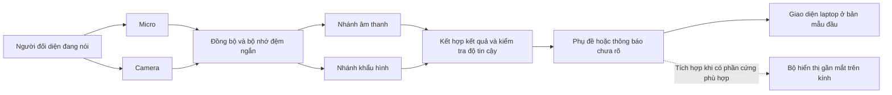

<div align="center">

# Auralens Research

### Vietnamese Audio-Visual Speech Intelligence

**Đưa lời nói vào tầm nhìn.**

Nghiên cứu kính thông minh hỗ trợ người khiếm thính bằng phụ đề tiếng Việt và nhận dạng lời nói kết hợp âm thanh — khẩu hình.

**Assistive AI · Multimodal Learning · Accessible Communication**

</div>

---

## Tổng quan dành cho đối tác và nhà đầu tư

Một cuộc trò chuyện trực tiếp không chỉ có âm thanh. Chuyển động của môi cũng mang thông tin về lời nói. **Auralens nghiên cứu cách kết hợp hai nguồn tín hiệu này để chuyển lời nói thành văn bản trong tầm nhìn của người dùng**, hướng tới trải nghiệm giao tiếp thuận tiện hơn cho người khiếm thính.

Tầm nhìn sản phẩm là một cặp kính có camera, micro và bộ hiển thị gần mắt, kết nối với bộ xử lý để tạo phụ đề. Trong giai đoạn đầu, nhóm sử dụng laptop để kiểm chứng thuật toán và trải nghiệm trước khi thu gọn phần cứng.

> **Giai đoạn hiện tại: thiết kế nghiên cứu và chuẩn bị nguyên mẫu.** Repository hiện chứa định hướng dự án và kế hoạch triển khai cho nhóm 5 sinh viên năm 3 ngành Trí tuệ nhân tạo. Chưa có mã ứng dụng, model do nhóm huấn luyện, kết quả benchmark hay sản phẩm kính hoàn thiện được công bố trong repository này.

### Giá trị hướng tới

- **Theo dõi hội thoại trong tầm nhìn:** hướng tới phụ đề trên kính, giúp giảm nhu cầu liên tục nhìn xuống một thiết bị cầm tay.
- **Tận dụng thêm thông tin khi âm thanh khó nghe:** nghiên cứu việc bổ sung khẩu hình có cải thiện nhận dạng trong điều kiện nhiễu hay không.
- **Tập trung vào tiếng Việt:** xây quy trình dữ liệu, đánh giá và giao diện phù hợp với ngôn ngữ sử dụng của nhóm người dùng mục tiêu.
- **Thể hiện giới hạn rõ ràng:** khi tín hiệu không đủ, hệ thống dự kiến thông báo chưa nhận dạng rõ thay vì luôn đưa ra một câu chắc chắn.

Các mục trên là mục tiêu thiết kế cần được kiểm chứng, chưa phải cam kết hiệu năng của sản phẩm đã triển khai.

## Vấn đề chúng tôi lựa chọn giải quyết

Trong giao tiếp mặt đối mặt, người dùng cần theo dõi nội dung, nét mặt và bối cảnh gần như cùng lúc. Một giải pháp phụ đề hữu ích cần vừa nhận dạng được lời nói, vừa hiển thị dễ đọc và phản hồi đủ nhanh để không làm gián đoạn hội thoại.

Auralens bắt đầu từ một tình huống cụ thể: **hội thoại một–một bằng tiếng Việt, trong đó camera nhìn được khuôn mặt người đang nói**. Nhóm ưu tiên hiểu rõ điều kiện hoạt động của hệ thống trước khi mở rộng sang nhiều người nói, môi trường phức tạp hoặc thiết bị đeo độc lập.

## Giải pháp dự kiến

Hệ thống thu âm thanh và hình ảnh cùng thời điểm, xử lý riêng từng nguồn rồi kết hợp bằng chứng để tạo kết quả. Văn bản sau đó được đưa tới giao diện phụ đề và, khi phần cứng đáp ứng, bộ hiển thị trên kính.



*Sơ đồ mô tả kiến trúc dự kiến của nhánh nghe–nhìn. Nhánh ASR tự do sử dụng âm thanh riêng, như phân biệt bên dưới.*

### Hai phạm vi kỹ thuật trong nguyên mẫu đầu

**1. Phụ đề tiếng Việt tự do từ âm thanh**  
Dùng model nhận dạng giọng nói có sẵn để chuyển lời nói thành văn bản. Đây là nền tảng chức năng và mốc tham chiếu trải nghiệm; chưa có đóng góp từ khẩu hình trong chế độ này.

**2. Nhận dạng nghe–nhìn trên 10 câu định trước**  
Xây và so sánh ba phương pháp: chỉ nghe, chỉ nhìn và kết hợp nghe–nhìn. Đầu ra thuộc một danh sách câu hữu hạn. Phạm vi này giúp kiểm chứng ý tưởng trong bốn tuần; không được hiểu là khả năng đọc khẩu hình tiếng Việt tổng quát.

Nguyên mẫu bắt đầu bằng nhận dạng từng đoạn với thao tác bắt đầu/dừng thu. Nhận dạng liên tục và phần cứng tích hợp trên gọng kính là các bước phát triển tiếp theo, phụ thuộc kết quả đo và nguồn lực.

## Nền tảng khoa học và hướng đóng góp

Audio-Visual Speech Recognition (AVSR) là một hướng nghiên cứu đã có nền tảng. [AV-HuBERT](https://arxiv.org/abs/2201.02184) nghiên cứu biểu diễn học từ âm thanh và hình ảnh; [ViCocktail](https://arxiv.org/abs/2506.04635) cung cấp một hướng nghiên cứu AVSR dành cho tiếng Việt. Auralens kế thừa các hướng nghiên cứu này, không tuyên bố phát minh ra AVSR.

Câu hỏi của giai đoạn đầu:

> **Với người nói chưa xuất hiện trong dữ liệu huấn luyện, thông tin khẩu hình có cải thiện khả năng nhận dạng 10 câu giao tiếp tiếng Việt trong điều kiện nhiễu hay không?**

Đóng góp nhóm hướng tới gồm một quy trình dữ liệu có thể kiểm tra, phép so sánh công bằng giữa các nguồn tín hiệu và một nguyên mẫu hiển thị phụ đề. Khả năng cải thiện độ chính xác phải được xác nhận bằng thí nghiệm; một kết quả không cải thiện cũng sẽ được báo cáo.

## Kế hoạch kiểm chứng

- **Dữ liệu dự kiến:** 10 người nói × 10 câu × 4 lần thu, tương đương 400 đoạn; chia theo người thành 6 train, 2 dev và 2 test. Thu thêm 40 đoạn ngoài danh sách cho dev/test để khảo sát việc từ chối câu lạ.
- **Điều kiện so sánh:** âm thanh gốc, nhiễu tổng hợp SNR +10 dB và 0 dB; cùng một đoạn hình và âm thanh cho các phương pháp được so sánh.
- **Chất lượng nhận dạng:** accuracy, macro-F1 và ma trận nhầm lẫn cho bài 10 câu; CER đánh giá riêng cho ASR tự do.
- **Độ tin cậy khi sử dụng:** số mẫu không trả lời, tỷ lệ chấp nhận nhầm câu lạ và hành vi khi mất camera hoặc micro.
- **Trải nghiệm:** độ trễ có cách đo rõ ràng, khả năng đọc phụ đề và hoàn thành tác vụ của người thử.

Chọn tham số trên dev và khóa cấu hình trước khi đánh giá test. Câu mẫu có thể xuất hiện ở cả ba tập nhưng người nói phải tách biệt; thí nghiệm này kiểm tra người mới, chưa chứng minh khả năng hiểu câu mới. Với số người test nhỏ, kết quả chỉ mang tính thăm dò.

**Trạng thái bằng chứng hiện tại:** các con số trên là thiết kế thí nghiệm, chưa phải dữ liệu đã thu hoặc kết quả đã đạt.

## Lộ trình bốn tuần

1. **Tuần 1 — Xác lập nền tảng:** chốt phạm vi, quy chuẩn dữ liệu, thử thu âm/hình, dựng giao diện và kiểm tra thiết bị.
2. **Tuần 2 — Xây nguyên mẫu:** hoàn thành dữ liệu theo kế hoạch, xây baseline âm thanh/khẩu hình và nối luồng hiển thị.
3. **Tuần 3 — Kiểm chứng trên dev:** thử nhiễu, chọn trọng số kết hợp, kiểm tra lỗi và khóa phiên bản.
4. **Tuần 4 — Đánh giá và trình diễn:** chạy test độc lập, hoàn thiện báo cáo, ghi nhận giới hạn và chuẩn bị demo.

Khối lượng kế hoạch: khoảng 12 giờ/người/tuần. Mốc bàn giao, tiêu chí nghiệm thu và tài liệu học được nêu trong từng bản phân công.

## Đội ngũ và tài liệu triển khai

Nhóm gồm **5 sinh viên năm 3 ngành Trí tuệ nhân tạo**. Phân vai theo đầu ra chuyên môn, có mốc bàn giao để các thành viên làm song song:

1. [Trưởng nhóm — Dữ liệu và đánh giá](docs/plans/01_thanh_vien_1_truong_nhom_du_lieu_danh_gia.md): đề cương, quy chuẩn dữ liệu, kiểm soát test và báo cáo tổng hợp.
2. [Âm thanh — Nhận dạng lời nói](docs/plans/02_thanh_vien_2_am_thanh_ASR.md): ASR tiếng Việt, đặc trưng âm thanh và baseline 10 câu.
3. [Thị giác — Khẩu hình](docs/plans/03_thanh_vien_3_thi_giac_khau_hinh.md): vùng miệng, đặc trưng chuyển động và baseline hình ảnh.
4. [AI đa phương thức — Tích hợp](docs/plans/04_thanh_vien_4_ket_hop_model_tich_hop.md): đồng bộ, kết hợp model và pipeline suy luận.
5. [Ứng dụng — Hiển thị và phần cứng](docs/plans/05_thanh_vien_5_ung_dung_hien_thi_phan_cung.md): giao diện phụ đề, thử khả dụng và khảo sát kính.

Mỗi tài liệu có nhiệm vụ theo tuần, kiến thức cần học, nguồn học, yêu cầu báo cáo và phương án xử lý khi chậm tiến độ. Thành viên mới nên đọc tài liệu số 1 trước.

## Hướng phát triển sản phẩm và hợp tác

Sau giai đoạn kiểm chứng, quyết định tiếp theo sẽ dựa trên dữ liệu: liệu phần hình ảnh mang lại lợi ích đủ lớn để bù chi phí xử lý, năng lượng và độ phức tạp của thiết bị đeo hay không?

Nếu kết quả hỗ trợ hướng đi này, nhóm dự kiến mở rộng theo ba bước:

- **Xác nhận nhu cầu:** làm việc cùng người khiếm thính để hiểu tình huống sử dụng, cách trình bày phụ đề và những khó khăn ưu tiên.
- **Mở rộng kỹ thuật:** tăng số người nói và độ đa dạng dữ liệu, khảo sát model AVSR tiếng Việt phù hợp, giảm độ trễ trên thiết bị đích.
- **Thử nghiệm phần cứng:** tích hợp bộ hiển thị gần mắt tương thích, đo khả năng đọc, trọng lượng, nhiệt và thời lượng sử dụng.

Hướng thương mại cần được khám phá thông qua thử nghiệm với người dùng và đối tác triển khai. Giá bán, chi phí phần cứng, mô hình doanh thu và nhu cầu thị trường chưa được xác thực ở giai đoạn này.

### Nguồn lực có thể tạo tác động trực tiếp

Nhóm mong muốn kết nối với cố vấn về speech/vision, đối tác phần cứng hiển thị và cộng đồng người dùng đồng ý tham gia thử nghiệm. Nguồn hỗ trợ ban đầu, nếu có, sẽ ưu tiên thu và kiểm tra dữ liệu, tài nguyên tính toán, thiết bị nguyên mẫu và đánh giá khả dụng.

Mỗi khoản đầu tư vào phát triển nên gắn với một mốc kiểm chứng cụ thể: **dữ liệu đạt chuẩn → benchmark tái lập → trải nghiệm có phản hồi → quyết định tích hợp phần cứng**.

## Nguyên tắc phát triển

- Có sự đồng ý của người tham gia trước khi thu hình/giọng; xác định rõ mục đích, quyền truy cập và thời hạn lưu.
- Không đưa dữ liệu khuôn mặt, giọng nói, thông tin liên hệ hoặc khóa truy cập vào lịch sử Git.
- Ưu tiên xử lý cục bộ và bộ nhớ đệm ngắn trong thiết kế; đây là định hướng cần được hiện thực và kiểm tra.
- Hiển thị trạng thái chưa rõ khi phù hợp; không dùng việc sửa văn bản tự động để che lỗi nhận dạng trong thí nghiệm.
- Phân biệt dữ liệu thật, dữ liệu giả lập, demo ghi trước và demo trực tiếp.
- Ghi nhận nguồn, model và giấy phép của thành phần sử dụng lại. Repository chưa cấp giấy phép mã nguồn mở cho nội dung do nhóm phát triển.

## Nội dung repository hiện tại

```text
auralens-avsr/
├── AGENTS.md
├── README.md
├── .gitignore
└── docs/
    ├── plans/               # Phân công cho TV1–TV5
    └── progress/
        ├── README.md       # Quy trình báo cáo và định nghĩa trạng thái
        ├── week-01/        # TV1.md ... TV5.md
        ├── week-02/
        ├── week-03/
        └── week-04/
```

Xem [quy trình cập nhật tiến độ](docs/progress/README.md) và [luật chung cho agent](AGENTS.md). Mỗi thành viên cập nhật báo cáo tuần trong cùng PR với công việc; tiến độ chính thức nằm trên `main` sau review. Các báo cáo khởi tạo hiện ở trạng thái chưa báo cáo.

Repository được khởi tạo ở chế độ **Private** để nhóm phát triển tài liệu và nguyên mẫu. Chưa có hướng dẫn cài/chạy ứng dụng vì mã ứng dụng chưa được triển khai.

**Đầu mối dự án:** [Stuckwthuw / Hiếu Lê](https://github.com/Stuckwthuw). Đối tác được chia sẻ quyền truy cập có thể trao đổi với đầu mối để nhận phạm vi thử nghiệm và tiến độ mới nhất; repository private chỉ xem được khi được cấp quyền.

---

*Auralens Research — từ giả thuyết có cơ sở đến bằng chứng có thể kiểm tra.*
