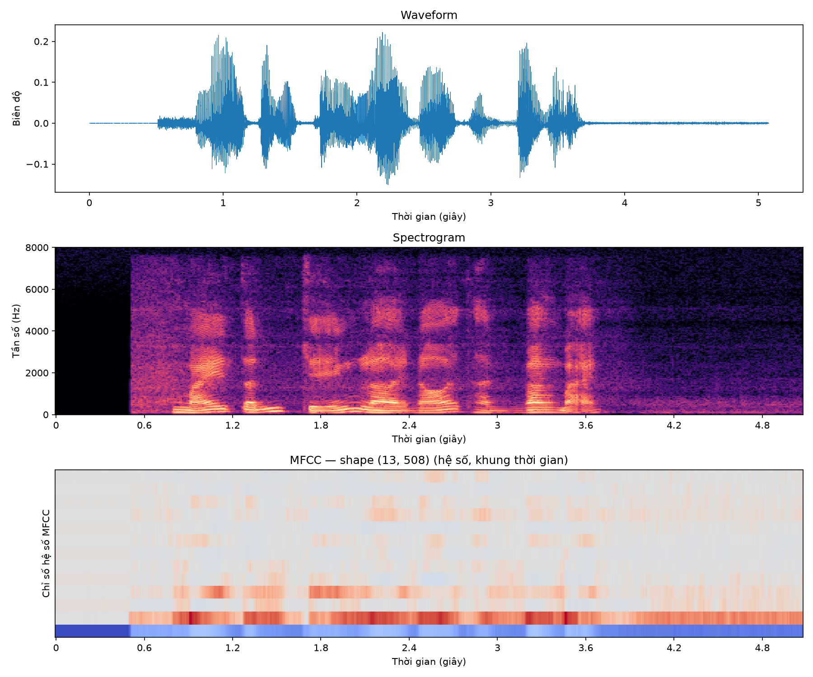
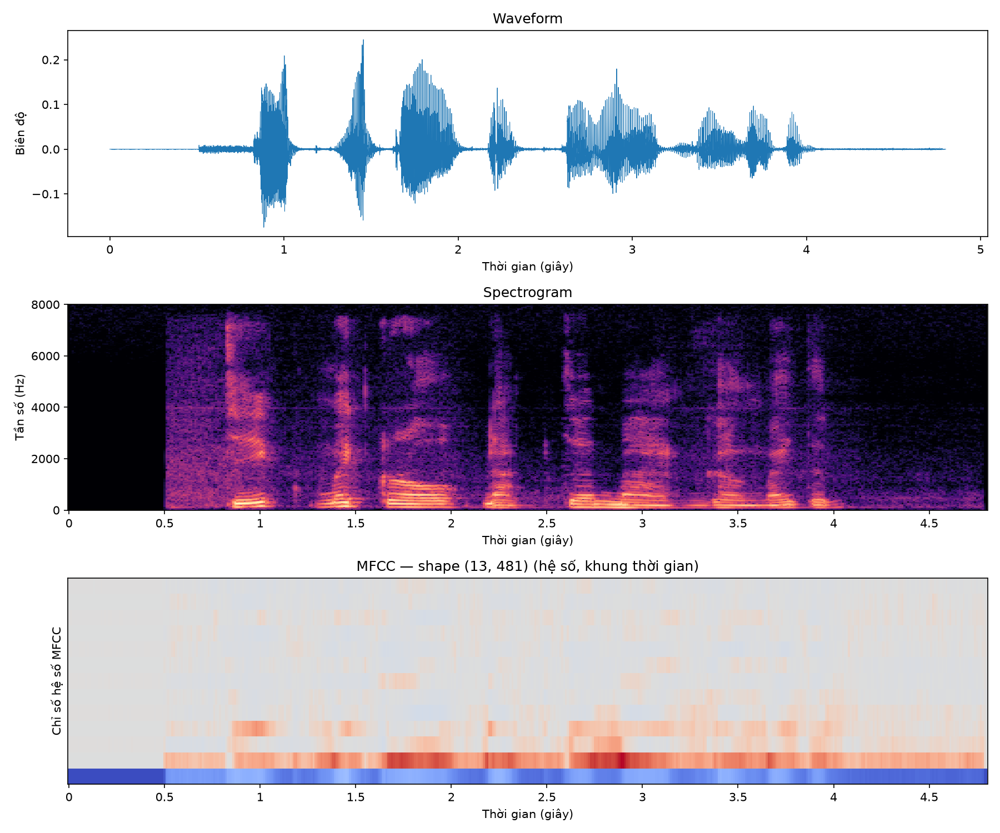

# TV2 — Dương — Tuần 01: Hiểu âm thanh và dựng hai đầu vào

- Người phụ trách: Dương.
- Trạng thái báo cáo: IN PROGRESS.
- Thời gian bắt đầu/kết thúc tuần: chưa xác định; cần đối chiếu ngày bắt đầu dự án với nhóm.
- Cập nhật lần cuối: 2026-11-16.
- Nhánh công việc: `docs/tv2-duong-week01-progress`.
- Kế hoạch gốc: [phân công TV2](../../plans/02_thanh_vien_2_am_thanh_ASR.md).

> Báo cáo ghi lại bằng chứng hiện có của TV2. API đã được TV2 chuẩn bị/gửi để TV4 xác nhận; chưa ghi là đã được TV4 xác nhận hoặc tích hợp. Các bản ghi WAV/TXT được giữ ngoài Git trong thư mục pilot cá nhân.

## 1. Nhiệm vụ được giao trong tuần

- [x] Ngày 1: kiểm tra Python/môi trường, CPU/GPU/RAM và thiết bị thu; đã ghi phiên bản và thông số máy ở mục 2.
- [ ] Đối chiếu thiết bị thu và phối hợp kiểm tra cùng TV5; chưa có xác nhận trong ghi chú hiện tại.
- [x] Ngày 2: thu WAV, nghe lại và kiểm tra kênh, tần số lấy mẫu, thời lượng, clipping.
- [x] Ngày 3–4: chạy ASR trên ít nhất 10 đoạn tiếng Việt pilot, chế độ chép lời.
- [x] Viết và chạy hàm ASR trả text + thời gian xử lý; giữ model đã nạp giữa các lần suy luận.
- [x] Tạo script/hình waveform, spectrogram, MFCC cho hai bản ghi; ghi shape và đơn vị trục.
- [x] Hỗ trợ pilot hội thoại hai người bằng WAV/TXT riêng.
- [x] TV2 đã chuẩn bị/gửi API để TV4 xác nhận phần của mình.
- [ ] Chờ TV4 xác nhận API và thử gọi hàm trong pipeline.

## 2. Công việc thực tế và trạng thái

### Môi trường và thiết bị

- Máy: Intel Core i5-10300H @ 2.50 GHz, 4 nhân/4 luồng; RAM 15.8 GB khả dụng (~16 GB lắp đặt); NVIDIA GeForce GTX 1650, VRAM chuyên dụng 4 GB; Intel UHD Graphics.
- Thiết bị thu mặc định: Microphone Array (Realtek(R) Audio).
- Hệ điều hành: Windows; phiên bản cụ thể chưa ghi.
- Môi trường Python riêng: Python 3.14.4; lệnh tạo môi trường dùng chung có trong bàn giao ASR pilot.
- ASR: `faster-whisper` 1.2.1, model `medium`, CPU `int8`, ngôn ngữ Vietnamese (`vi`), tác vụ `transcribe`. Máy có GPU rời nhưng lần chạy được ghi nhận dùng CPU.
- Cấu hình gói truy cập được cho nhóm: [`requirements-pilot.txt`](../../../auralens/audio/requirements-pilot.txt); môi trường gồm Faster-Whisper và các phụ thuộc, cùng `librosa` 1.0.1 và `matplotlib` 3.11.2.
- Chưa có xác nhận về buổi phối hợp thiết bị với TV5; cần bổ sung nếu đã diễn ra.

### Thu âm và ASR pilot

- Có 10 WAV pilot duy nhất và 10 TXT Buzz ghép theo tên gốc từ `Untitled.wav` đến `Untitled10.wav` (bỏ số 1 theo cách Sound Recorder đặt tên). Buzz được Dương báo cáo chạy Whisper.cpp Medium, Vietnamese, Transcribe.
- Định dạng 10 WAV: PCM 16-bit, mono; 9 file 16 kHz, `Untitled9.wav` 48 kHz; thời lượng 3.520–7.680 giây.
- Đo `volumedetect` trên 10 file: peak −10.3 đến −16.7 dBFS; không thấy clipping số. Mean −29.8 đến −34.9 dBFS. Đo này không thay thế việc nghe đánh giá ồn nền/méo analog.
- Mã ASR đã đưa vào repo: [`asr_pilot.py`](../../../auralens/audio/asr_pilot.py). Hàm `FasterWhisperASR.transcribe_file(audio_path)` trả `text` và `infer_ms`; model được nạp khi tạo đối tượng và tái sử dụng cho nhiều file.
- Đã chạy hai WAV trong cùng tiến trình: thời gian model sẵn sàng 5,138 ms; `Untitled9.wav` nhận dạng 6,963 ms; `Untitled4.wav` nhận dạng 7,559 ms. Đây là hai lượt chạy file cục bộ, không phải độ trễ streaming.
- Pilot có hội thoại hai người `tini.wav` và TXT Buzz tương ứng: PCM 16-bit, mono, 16 kHz, 38.933 giây. Theo đánh giá của Dương, phần lớn nội dung được nhận dạng ổn; các lỗi được chia sẻ gồm tên riêng bị rút gọn, một cụm danh từ bị chèn từ, và một tựa game bị sai dấu. Đây là hội thoại tự nhiên riêng, không gộp vào 10 câu pilot đọc; transcript đầy đủ không được chia sẻ trong repo.
- Log nhóm truy cập được, gồm 10 kết quả Buzz đã bỏ đường dẫn cá nhân, cùng timing Faster-Whisper: [bàn giao ASR pilot](../../handoffs/tv2-week01-asr-pilot.md). WAV và transcript hội thoại tự nhiên vẫn nằm ngoài Git.

### Biểu đồ âm thanh

- Script tái tạo đã đưa vào repo: [`plot_pilot.py`](../../../auralens/audio/plot_pilot.py); hướng dẫn cài và chạy ở [bàn giao ASR pilot](../../handoffs/tv2-week01-asr-pilot.md).
- Hình đầu ra trong `docs/progress/week-01/assets/tv2/`: `Untitled_waveform_spectrogram_mfcc.png` và `Untitled10_waveform_spectrogram_mfcc.png`.
- Waveform: trục thời gian (giây) và biên độ chuẩn hóa. Spectrogram: thời gian (giây), tần số (Hz; 0–8,000 Hz với tín hiệu 16 kHz). MFCC: chỉ số hệ số và thời gian; hai shape là `(13, 508)` và `(13, 481)` (hệ số, khung thời gian).
- Cấu hình hiển thị MFCC: 13 hệ số, khung 32 ms (`n_fft=512` ở 16 kHz), bước 10 ms (`hop_length=160`). Hai WAV gốc không được thêm vào repository; hai hình đặc trưng dẫn xuất được lưu cạnh báo cáo để hiển thị trực tiếp.

**Untitled.wav** — MFCC shape `(13, 508)`.

**Untitled10.wav** — MFCC shape `(13, 481)`.

### API và bàn giao

- TV2 đã chuẩn bị/gửi phần API ASR để TV4 xác nhận; phía TV4 chưa có xác nhận được ghi nhận trong báo cáo này.
- API local hiện nhận đường dẫn file và trả `{"text": ..., "infer_ms": ...}`. Chưa có bằng chứng hàm đã được TV4 gọi trong pipeline tích hợp.
- Trạng thái API: IMPLEMENTED — mã, cấu hình, hướng dẫn chạy và log đã được đưa vào repo. Bản sao trong repo chưa được TV4 chạy/kiểm tra độc lập; chưa tích hợp.

## 3. Kiến thức đã học và áp dụng

- Thực hành với WAV, mono/stereo, sample rate, thời lượng và kiểm tra clipping.
- Chạy ASR tiếng Việt theo chế độ Transcribe; hiểu vai trò của model được nạp một lần và thời gian suy luận riêng.
- Đã tạo/quan sát waveform, spectrogram, MFCC. Dương đã nắm cách đọc waveform và spectrogram ở mức cơ bản; cách hoạt động từng dòng trong script Python còn cần luyện thêm.
- ChatGPT hỗ trợ giải thích khái niệm, đề xuất câu pilot, hướng dẫn viết/chạy script, phân tích số đo và chuẩn bị nội dung báo cáo. Dữ liệu WAV là dữ liệu thật do Dương thu; transcript Buzz/Faster-Whisper là đầu ra thật của các công cụ. ChatGPT không tạo âm thanh hoặc thay transcript. Theo yêu cầu của Dương, không liệt kê thao tác cài đặt/xóa phần mềm trong khai báo AI.

## 4. Kiểm tra và số liệu

- Đã kiểm tra metadata và mức peak của 10 WAV bằng `ffprobe` và FFmpeg `volumedetect`; log nhóm truy cập được ở [bàn giao ASR pilot](../../handoffs/tv2-week01-asr-pilot.md).
- Đã xác nhận đủ 10 WAV và 10 TXT Buzz duy nhất bằng đối chiếu nội dung hai thư mục.
- Đã chạy hàm Faster-Whisper Medium với hai file liên tiếp trong một tiến trình; model không nạp lại giữa hai lần gọi.
- Đã chạy script vẽ trên hai WAV; ảnh thể hiện đủ ba đồ thị, đơn vị trục và shape MFCC.
- Chưa có benchmark CER đầy đủ: chưa xác nhận transcript gốc cho toàn bộ 10 câu và chưa tính CER.
- Chưa chạy kiểm tra tích hợp qua TV4; chưa xác minh hành vi micro trong ứng dụng của TV5.

## 5. Vướng mắc và hỗ trợ cần thiết

- Cần TV4 xác nhận API và thử gọi hàm trong pipeline; không coi API là INTEGRATED trước khi có bằng chứng.
- Cần xác nhận ngày bắt đầu dự án để ghi đúng thời gian tuần.
- Cần bổ sung phiên bản Windows và xác nhận đã phối hợp thiết bị với TV5 nếu có.
- Cần nghe lại/xác nhận câu gốc cho các pilot chưa có nhãn tham chiếu trước khi tính CER.
- Dương đang tiếp tục học cách đọc/hiểu mã `plot_pilot.py`.

## 6. Bàn giao, review và tích hợp

- Đầu ra nhóm truy cập được: [`asr_pilot.py`](../../../auralens/audio/asr_pilot.py), [`plot_pilot.py`](../../../auralens/audio/plot_pilot.py), [`requirements-pilot.txt`](../../../auralens/audio/requirements-pilot.txt), [lệnh chạy và log đã khử thông tin cá nhân](../../handoffs/tv2-week01-asr-pilot.md), cùng hai ảnh phân tích nhúng ở trên.
- Dữ liệu WAV/TXT và ghi chú đầy đủ vẫn nằm ngoài Git trong kho cá nhân; không commit dữ liệu giọng nói.
- Người nhận API: TV4; chờ xác nhận đầu vào/đầu ra và kiểm tra gọi hàm.
- Cập nhật mã, cấu hình và log được đưa vào cùng PR #5 trên nhánh `docs/tv2-duong-week01-progress`; chờ review/kiểm tra độc lập.
- Không đưa WAV/TXT có giọng nói hoặc hội thoại vào Git.

## 7. Việc tiếp theo và thời gian thực tế

- TV4 xác nhận API và thử gọi hàm; ghi lại kết quả xác nhận khi có.
- TV5 xác nhận thiết bị thu/phối hợp nếu checklist yêu cầu buổi phối hợp.
- Xác minh ngày bắt đầu tuần với nhóm; bổ sung phiên bản Windows.
- Hoàn thiện nhãn câu gốc và CER nếu có đủ transcript tham chiếu.
- Tiếp tục luyện giải thích luồng của `plot_pilot.py`.
- Thời gian thực tế đã dùng: chưa thống kê; không suy từ kế hoạch 12 giờ/tuần.
